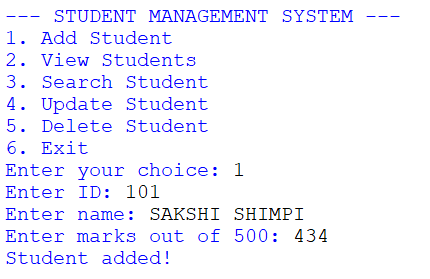
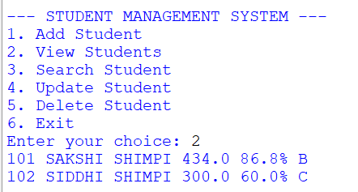
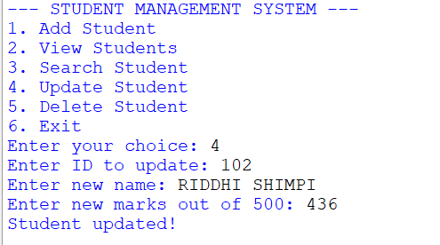
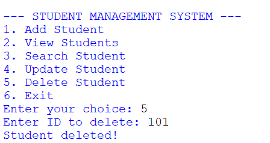
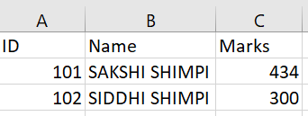
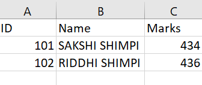
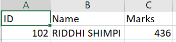

# 🎓 Student Management System Using Python OOP

## 📌 About the Project

The Student Management System is a menu-driven Python application developed using Object-Oriented Programming (OOP) concepts and CSV file handling.

It allows users to manage student records efficiently by performing CRUD (Create, Read, Update, Delete) operations. The system stores student details such as ID, name, and marks in a CSV file and automatically calculates percentages and grades based on the marks obtained.

The application provides a simple and user-friendly console interface for managing student information.

## 🛠️ Technologies Used

- Python
- CSV Module
- ABC Module
- Object-Oriented Programming (OOP)
- File Handling

## ✨ Features

- **Add Student:** Add new student records with ID, name, and marks.
- **View Students:** Display all registered student records with percentages and grades.
- **Search Student:** Search for a student using their unique ID.
- **Update Student:** Modify existing student names and marks.
- **Delete Student:** Remove student records using their ID.
- **Grade Calculation:** Automatically calculate percentages and assign grades.
- **Duplicate ID Validation:** Prevent duplicate student IDs.
- **Marks Validation:** Ensure marks entered while adding a student are between 0 and 500.
- **CSV File Handling:** Store student records permanently in a CSV file.

## ⚙️ Working Principle

1. The program displays a menu containing six options: Add Student, View Students, Search Student, Update Student, Delete Student, and Exit.
2. The user selects an option based on the required operation.
3. When adding a student, the system accepts the student ID, name, and marks out of 500.
4. The system checks for duplicate student IDs and validates marks.
5. Student records are stored in the `students.csv` file.
6. Users can view, search, update, or delete student records using their student ID.
7. The system calculates the percentage using the formula:

   **Percentage = (Marks / 500) × 100**

8. Based on the percentage, the system automatically assigns a grade.
9. The updated student information is saved in the CSV file.

## 📊 Grading System

| Percentage | Grade |
|---|---|
| 90% and above | A |
| 75% – 89% | B |
| 50% – 74% | C |
| Below 50% | Fail |

## 📸 Project Screenshots

### 1. Add Student
Demonstrates adding a new student with ID, name, and marks.



### 2. View Students
Displays all student records along with their percentages and grades.



### 3. Search Student
Searches for a particular student using their unique ID.


### 4. Update Student
Demonstrates updating an existing student's name and marks.



### 5. Delete Student
Demonstrates deleting a student record using their ID.



## 📁 CSV File Handling

The system uses `students.csv` to store student records permanently.

The CSV file contains three columns:

| ID | Name | Marks |
|---|---|---|
| 101 | SAKSHI SHIMPI | 434 |
| 102 | RIDDHI SHIMPI | 436 |

### CSV Operations

**Adding Records:**



**Updating Records:**



**Deleting Records:**



## 💻 OOP Concepts Used

- **Abstraction:** Uses an abstract `Student` class with an abstract `get_grade()` method.
- **Inheritance:** The `RegularStudent` class inherits from the `Student` class.
- **Encapsulation:** Student details and related operations are organized within classes.
- **Polymorphism:** The `get_grade()` method is implemented in the `RegularStudent` class to provide grade calculation.

## 🚀 How to Run the Project

1. Install Python on your system.
2. Download or clone the project repository.
3. Open the project folder in VS Code.
4. Make sure `oops.py` and `students.csv` are in the project folder.
5. Open the terminal in VS Code.
6. Run the following command:

```bash
python oops.py
```

7. Select an option from the menu to perform student management operations.
8. The student records will automatically be stored in the CSV file.

## 📂 Project Structure

```text
Student-Management-System/
│
├── oops.py
├── students.csv
├── ADD.png
├── VIEW.png
├── SEARCH .png
├── UPDATE.png
├── DELETE.png
├── CSV-ADD.png
├── CSV-UPDATE.png
├── CSV-DELETE.png
└── README.md
```

## 🎯 Learning Outcomes

- Understanding Object-Oriented Programming concepts in Python.
- Implementing abstraction, inheritance, encapsulation, and polymorphism.
- Working with CSV files for permanent data storage.
- Performing CRUD operations using Python.
- Implementing data validation and duplicate ID checking.
- Understanding automatic percentage and grade calculation.
- Developing menu-driven Python applications.

## 👩‍💻 Author

**Sakshi Shimpi**

- GitHub: [sakshishimpi03](https://github.com/sakshishimpi03)
- LinkedIn: [sakshi-shimpi](https://linkedin.com/in/sakshi-shimpi)

---
